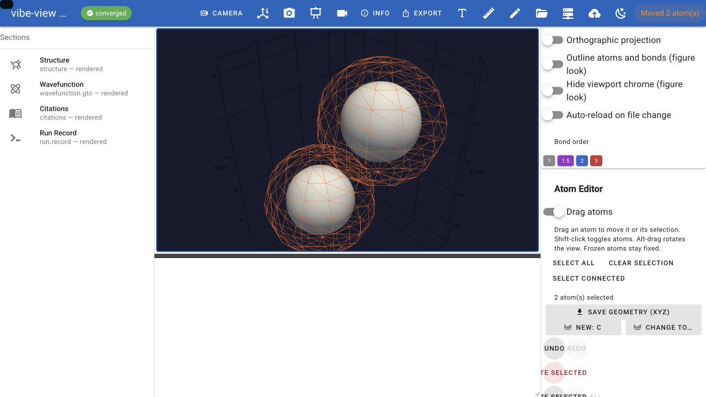

# Building and editing structures

The browser and desktop surfaces are an editor as well as a viewer. You can
change a structure atom by atom, grow it from fragments, sketch one in
vibe-sketch or build it from a name or a SMILES string, replicate a cell or
cut a slab, and hand the result
to a calculation: exported as an input script, or submitted to a queue
without leaving the window.

Everything on this page runs in `vibe-view open` and `vibe-view desktop`.
The terminal and headless surfaces read structures; they do not edit them.

vibe-view owns detailed **3D structure work for calculations**; vibe-sketch
owns **2D chemical drawing and reaction figures for papers**. Both retain
input, drawing, basic optimisation and calculation workflows. See the
[shared scope decision](sketch_view_scope.md), including vibe-sketch's
planned reference-geometry and FIRE cleanup.

## Edit mode

Press <kbd>e</kbd> or the pencil icon. The **Atom Editor** card opens and
the viewport starts taking clicks as edits:

* **Select** an atom by clicking it; a selected atom carries an orange
  wireframe highlight. Click again to deselect, <kbd>Delete</kbd> to remove
  the selection.
* **Add** an atom by clicking empty space. The element comes from the
  *Element used for newly added atoms* picker.
* **Change every selected atom's element** with the element picker in the
  card.
* **Undo / redo** with <kbd>Ctrl</kbd>/<kbd>Cmd</kbd>+<kbd>Z</kbd> and
  <kbd>Ctrl</kbd>/<kbd>Cmd</kbd>+<kbd>Shift</kbd>+<kbd>Z</kbd>. Every edit is
  one undo step.

Unspecified bonds use the same covalent-radius rule the viewer draws with.
Explicit bonds keep their orders through edits; deleting atoms remaps their
indices. Connections involving newly added atoms are inferred without restoring
a manually removed bond between existing atoms. Periodic image bonds are retained. The edited
structure is drawn the way the unedited one is, in the representation and at
the replication you chose. Edits compound in
place: the geometry you export or submit is the geometry as edited, and the
original archive on disk is not touched.

An edit replaces the atom list, so the file's biomolecular metadata does not
carry over to the edited geometry: residue and chain names, B-factors, and
any producer-supplied residues, chains or secondary structure describe the
original atoms and are dropped. The views built on that metadata (cartoon
and backbone, colouring by chain, secondary structure or B-factor) have
nothing to draw from until the archive is reloaded.

Edit mode and measure mode are mutually exclusive; <kbd>Esc</kbd> leaves
either.

## Set exact distances, angles and dihedrals

Enable **Measure**, then click two, three or four atoms in order. In
**Measurements**, enter the new value and click **Apply exact value**.
Distances are always entered in Å; angles and signed dihedrals in degrees,
regardless of the measurement display unit. Three picks set the angle at the
middle atom; four set the signed dihedral in the displayed convention.

**Smaller fragment** moves the smaller connected side (ties move the last
side). **Other fragment** moves the opposite side; **Last atom only** changes
only the last picked atom. Whole fragments move rigidly. A ring or alternate
connected path is refused, including last-atom mode, instead of silently
distorting a ring. Frozen atoms must stay fixed; choose the other side when a
frozen atom blocks the proposed movement. Collinear undefined rotations and
periodic-image connectivity receive an explanation.

Each successful change is one Undo step and stops Auto-optimize so its exact
value remains unchanged. A refused change does not alter coordinates or undo
history. The edited coordinates feed XYZ, calculation inputs and vq submission.

## Edit bonds explicitly

In **Atom Editor**, select two atoms, choose order 1, 1.5 (aromatic), 2 or 3,
and click **Add / set bond**. **Remove bond** makes the absence explicit.
These changes are one undoable edit and stop Auto-optimize. Bond editing does
not claim that the chosen valence is chemically stable.

**Save geometry (QVF)** retains current coordinates, explicit bond orders and
the source's stated charge and multiplicity, without copying stale calculated
properties. A charge or multiplicity the source does not state stays unstated.
CML and the existing scene/figure
exports also consume the explicit connectivity. XYZ and ORCA input do not
encode explicit bonds; they carry the edited coordinates.

Python equivalents operate on an open reader, using zero-based atom indices:

```python
from vibeview.api import set_geometry_parameter, set_bond, export_geometry_qvf

set_geometry_parameter(reader, [0, 1], 1.42, side="smaller", frozen=[4])
set_geometry_parameter(reader, [0, 1, 2], 109.5, side="other")
set_bond(reader, 0, 1, 2)  # use order=0 to remove
export_geometry_qvf(reader, "prepared.qvf")
```

## Drag atoms and selections

Select **Structure**, press **e** to open **Atom Editor**, then enable
**Drag atoms**. Press an atom and drag it to move it. An atom outside the
current selection becomes the new selection when you grab it.

* **Shift-click** atoms to add them to, or remove them from, the selection.
  Drag any selected atom to translate all selected, unfrozen atoms together.
* **Select connected** expands the selection through bonds, so a connected
  molecule or fragment can be moved as a group. Start by selecting one or
  more atoms in the desired groups. Connectivity is the same as in the viewer.
* **Select all** selects every atom; **Clear selection** deselects everything.
* **Freeze Selected** keeps those atoms fixed, including when a larger
  selection is dragged. **Unfreeze All** releases them.

The movement follows the screen plane through the atom you grabbed. Rotate
the view and drag again to move along another direction in 3D. In drag mode,
**Alt-drag** rotates the camera, the middle mouse button pans and the wheel
zooms. Clicking empty space does not add an atom while **Drag atoms** is on;
turn it off to return to the ordinary add/select editor.

Every drag is one **Undo** step, regardless of the number of intermediate
positions shown. **Redo** reapplies the final coordinates. Releasing outside
the viewport or losing focus finishes at the last received position. If
**Auto-optimize** is enabled, it pauses during a drag and resumes on release.
Turn it off when the moved coordinates should remain unchanged for export.
For periodic structures, use replication **1 × 1 × 1** when dragging atoms.



**Save geometry (XYZ)** and generated calculation inputs use the edited
coordinates. Dragging never rewrites the original loaded result file.

## Detect molecular symmetry

Use **Detect point group** in the toolbar or command palette to inspect the
current geometry, including unsaved edits. The **Symmetry** card shows the
point group, principal axis and moments of inertia.

Linear molecules with two or more atoms report **D∞h** when inversion maps
each atom to an equivalent atom of the same element, or **C∞v** otherwise.
Their principal axis follows the molecular line. Detection uses a **0.1 Å**
position tolerance: small departures from linearity can still count as
linear, while bends outside that tolerance retain a finite point group.

## Save coordinates and break symmetry

In **Atom Editor**, **Save geometry (XYZ)** downloads the current edited
geometry as plain text: atom count, comment, then element and Cartesian
coordinates in Å. The toolbar's **Export → XYZ** does the same. The file
can be opened in any text editor; it contains the edited coordinates, not
the original coordinates from the loaded calculation.

To introduce a small random perturbation, set **Maximum displacement (Å)**
(default **0.01**, allowed range greater than zero through **0.1**) and click
**Random displacement**. Selected atoms move; if none are selected, all
atoms move. Frozen atoms always stay fixed. Each Cartesian component is
sampled independently within a cube chosen so that the total displacement
of each atom never exceeds the specified maximum. Repeated clicks produce
new perturbations. Each click is one **Undo** step; **Redo** restores exactly
that perturbation.

Displacement switches **Auto-optimize** off, including any pending run, so
the new coordinates remain available for export. Use it after pre-optimising
if the calculation should start from a slightly asymmetric structure.
This is a geometry perturbation tool, not a guarantee that a calculation's
linear-dependence warning will disappear.

## Displace along a normal mode

You can displace along one mode or a combination of selected modes.

Open a calculation containing normal modes (for ORCA, include its `.hess`
file) and select **Vibrations**. Choose a **Mode**, then enter **Signed peak
displacement (Å)** and click **Create displaced structure**. For example,
**0.10** and **−0.10** produce opposite distortions. Nonzero values through
**±1 Å** are accepted; the default is **0.10 Å**.

For a combination, choose two or more entries in **Modes to displace**.
Each selected mode gets its own **signed peak displacement (Å)** field.
For example, set one mode to **+0.10 Å** and another to **−0.05 Å**, then
click **Create displaced structure**. Only the selected modes contribute;
the animation's **Mode** selection does not add another contribution.
Clear **Modes to displace** to return to the single-mode workflow above.

The viewer returns to **Structure** with **Atom Editor** open. Use **Save
geometry (XYZ)**, prepare an ORCA input, or submit it through vq. **Undo**
restores the geometry before the displacement; **Redo** restores the exact
displaced coordinates. Animation and auto-optimisation stop when you apply it.

Each application uses the mode's equilibrium geometry, replacing current
coordinate edits in one undoable step. It never adds another displacement
on top of the last one. To make both directions, save the positive geometry,
return to **Vibrations**, enter the negative value and apply again.

For each mode, the longest atomic displacement vector has the absolute length you enter;
all other vectors scale by the same factor. The mode contributions are added:
`R = R_equilibrium + Σₖ aₖ dₖ / maxᵢ |dₖᵢ|`. The sum is not renormalized, so
its largest atomic movement can exceed an individual amplitude or cancel
through opposing contributions. Each coefficient must be nonzero and within
±1 Å; deselect a mode to omit it. Selections reset when switching sections
or calculations. This uses the stored Cartesian
mode, without further mass weighting, and is independent of the animation
amplitude or phase. Both real and imaginary modes can be used. The sign of
a mode vector is arbitrary, so “positive” refers to the direction stored in
that calculation. This is a geometry preparation tool, not an IRC trajectory
or a thermal amplitude.

The full mode moves the molecule regardless of atom selection. **Unfreeze
All** first if atoms are frozen. The operation rejects zero/non-finite mode
vectors, changed atom lists, and modes whose equilibrium geometry or
associated structure does not match. Legacy modes with all-zero equilibrium
coordinates use the archived structure, never its edited coordinates.
Original frequencies, spectra and orbitals still describe the original
calculation; obtain new properties with a new calculation.

The [ORCA peroxide tutorial](orca_raman_vcd.md#prepare-two-structures-along-a-mode)
walks through both directions using a real frequency result. For several
directions at once, follow [Combine selected modes](orca_raman_vcd.md#combine-selected-modes):
viewer Modes 7 and 8 have signed peak displacements of +0.10 and −0.05 Å.
The [follow-up calculation](orca_raman_vcd.md#calculate-the-displaced-structure-through-vq)
submits that combined geometry to ORCA through vq and opens a new dataset
with the resulting structure, orbitals and charges. Download either archive
to inspect it without running ORCA yourself.

## Fragments and hydrogens

The **Fragment Library** attaches a group to the last selected atom, one
bond length (1.5 Å) out from it, on the side facing away from the molecule's
centre. With nothing selected, the group is set down beside the structure,
2.5 Å past its largest x coordinate, so it never lands inside the molecule:

| Fragment | Group |
|---|---|
| `CH3` | methyl |
| `NH2` | amino |
| `OH` | hydroxyl |
| `COOH` | carboxyl |
| `Ph` | phenyl |
| `CHO` | aldehyde |
| `NO2` | nitro |
| `CN` | cyano |
| `CF3` | trifluoromethyl |
| `SO3H` | sulfonic acid |

**Add Hydrogens** saturates the open valences of the selected atoms with
tetrahedral geometry where it applies. The same operation is available for a
whole file from the command line:

```sh
vibe-view h-add structure.qvf -o structure_h.qvf
```

## Sketching a molecule in vibe-sketch

vibe-sketch is the family's 2D structure and reaction sketcher. When it is installed beside the viewer, **Sketch in
vibe-sketch** at the top of the **Build molecule** dialog opens it in your
browser. The command palette (Ctrl/Cmd+K) has the same action, as
*Sketch a molecule in vibe-sketch*. Draw the molecule, then choose **Send to
vibe-view** in the sketcher. The structure opens here as a new file and the
status bar says how many atoms it has. Send again after an edit and the new
version opens as another file, so you can compare it with the earlier one.

The sketcher runs on this machine at `http://127.0.0.1:8766/`, or the next
free port, and keeps running while the viewer is open. Clicking **Sketch**
again brings its page back rather than starting a second copy. Closing the
viewer also stops the sketcher, so save a drawing you want to keep in
vibe-sketch first.

vibe-sketch is the optional `[sketch]` extra. It is published on no package
index yet, so install it from a vibe-sketch checkout first. The extra is
then satisfied by what is already there:

```sh
python -m pip install <path-to-vibe-sketch>
python -m pip install -e '.[sketch]'   # from the vibe-view checkout
```

vibe-sketch needs Python 3.12 or newer. Without it the Sketch button stays
in the dialog, and clicking it puts the install command in the status bar.
`vibe-view doctor` lists the same command under `sketch`.

### The hand-off between the two programs

This is the contract vibe-sketch implements for *Send to vibe-view*
(vibe-view #77, vibe-sketch #1). It lives in `vibeview.sketch`:

* vibe-view starts `python -m vibesketch serve --host 127.0.0.1 --port PORT
  --open` with its own interpreter. The environment variable
  `VIBEVIEW_SKETCH_HANDOFF` names a private directory created for this
  sketcher. When the variable is set, the sketcher knows a viewer is waiting.
* *Send to vibe-view* writes the structure as a `.qvf` or `.xyz` file, then
  writes a record into that directory: a JSON object
  `{"schema": "vibe-view-sketch-handoff/1", "path": "<absolute path>"}`. The
  record is written under a name that does not end in `.json` and then
  renamed to `*.json`, so the viewer never reads half of it.
* About once a second, vibe-view reads new records in name order and deletes
  each one after reading it. It reads the structure into memory, so a later
  send that overwrites the same file does not change what is already open. A
  record that breaks the contract, or names a file that cannot be read, is
  reported in the status bar and opens nothing.
* When the viewer exits, it stops the sketcher and removes the directory. A
  missing directory tells the sketcher that the viewer is gone.

## Building from a name or a SMILES string

Below the Sketch button, the **Build molecule** dialog takes either:

* **A molecule name.** Geometries come from the curated structure database
  of the `vibeqc_naming` package, which ships with vibe-qc. A standalone
  viewer install does not have it, so the name field is left out of the
  dialog. The toolbar button still opens the dialog when vibe-sketch is
  installed.
* **A SMILES string.** Needs the `[smiles]` extra (RDKit). The geometry is
  an RDKit ETKDG embedding with no force-field cleanup: a chemically
  sensible starting point, not an optimised structure.

The **Structure Library** card remembers what you built, and lets you pin
favourites to reuse. It shows a thumbnail of the molecule you pick, and
each pinned and recent chip carries a small picture of its molecule. The
pictures are drawn in the background from the library's geometry once a
name is picked, pinned or used, so they appear a moment after the name.

From Python the SMILES route is a function that returns an in-memory
archive, so it can be handed straight to the viewer:

```python
from vibeview import launch_qvf
from vibeview.converters import smiles_to_qvf

launch_qvf(smiles_to_qvf("c1ccccc1"))                 # benzene
launch_qvf(smiles_to_qvf("CCO", add_hydrogens=False))
```

There is no `vibe-view` subcommand for SMILES and no SMILES file format the
open dialog accepts; the dialog and the function are the two routes.

## Live optimisation while you build

**Auto-optimize**, in the Atom Editor card, relaxes the sketch in the
background after every pause in editing and streams each optimiser step into
the viewport, so the atoms settle toward a relaxed geometry as you work. The
status line shows the step, energy and maximum gradient, then *relaxed in N
steps*. Editing again mid-relax cancels and reschedules, and each relax run
is one undo entry.

This needs vibe-qc importable in the viewer's environment: the default
engine is its MSINDO semi-empirical model, and when its `[mace]` extra is
installed an **Engine** picker offers the MACE foundation potential as well.
Without vibe-qc the switch snaps back off with the reason and the editor
works exactly as before. Structures beyond 80 atoms are skipped to keep the
background evaluations interactive.

Selected atoms can be **frozen** so a relaxation moves everything but them.

The **Optimizer** selector offers **L-BFGS (default)** and **FIRE (damped MD)**.
FIRE uses forces from the selected engine and adaptive, damped motion to
relax the geometry, following [Bitzek et al., Phys. Rev. Lett. 97, 170201
(2006)](https://doi.org/10.1103/PhysRevLett.97.170201). It does not need another
package beyond the selected energy/force engine. Its timestep is a numerical
relaxation parameter; this is not a finite-temperature MD trajectory.
FIRE allows up to 200 steps, limits each atom's move to 0.1 Å per step, and
uses the same maximum Cartesian gradient tolerance as L-BFGS
(0.002 Ha/bohr). If the step limit is reached, the status explicitly says
*not converged*. Changing the optimiser while **Auto-optimize** is on starts
a fresh run from the current geometry. **Undo** restores the geometry before
that run.

For a pre-optimisation after drawing: select the optimiser, turn on
**Auto-optimize**, wait for *relaxed in N steps*, then turn it off before
exporting. See the [ORCA builder walkthrough](orca.md#build-and-pre-optimise-an-orca-starting-geometry)
for the complete sequence.

## Periodic structures

**Build Supercell** replicates the cell `Nx × Ny × Nz` into a new structure;
the command-line equivalent is:

```sh
vibe-view supercell si.qvf --nx 2 --ny 2 --nz 2 -o si_2x2x2.qvf
```

The crystal-builder helpers behind it are importable for scripts: a
space-group search, conversion between a lattice matrix and cell parameters,
Miller-plane slab cutting with a vacuum gap, and supercell replication.
`miller_slab` works for any orientation of a nonsingular cell: it builds the (hkl)
surface cell from two lattice vectors that lie in the plane and one that steps
a single interplanar spacing along the normal, repeats the parent cell's atoms
`n_layers` times along that step, and adds `2 * vacuum` to the cell length
along the normal. The atoms are not shifted to center them in that padding,
so the gaps on either side need not be equal. The in-plane vectors and the
atoms stay in the parent crystal's Cartesian frame, so the slab overlays the
bulk it was cut from. The determinant-one surface basis preserves the input
cell's handedness. `n_layers`
counts repetitions of the cell, so a conventional fcc cell gives one atomic
plane per layer for (111) and two for (001); indices with a common factor,
such as (002), name the same plane family as their reduced form.

```python
from vibeview.crystal_builder import (
    search_space_groups, cell_from_abc, abc_from_cell, miller_slab, replicate_cell,
)

search_space_groups("Fm-3m")                          # [{'number': 225, ...}]
cell = cell_from_abc(5.43, 5.43, 5.43, 90, 90, 90)
a, b, c, alpha, beta, gamma = abc_from_cell(cell)
new_cell, slab_atoms = miller_slab(cell, atoms, hkl=(1, 1, 1), n_layers=3, vacuum=15.0)
super_cell, super_atoms = replicate_cell(cell, atoms, nx=2, ny=2, nz=2)
```

`cell_from_abc` requires finite positive lengths and finite angles strictly
between 0° and 180°. The angles must also form a nondegenerate 3D cell;
impossible or coplanar combinations raise `ValueError`. Valid narrow angles
retain their nonzero volume.

Cell edges are only drawn along periodic axes, so a slab gets its in-plane
parallelogram and never a box around the vacuum.

## From structure to calculation

### The Calculation Parameters panel

Select **Calculation engine → ORCA** for basic molecular ORCA preparation,
input preview, `.inp` download and vq submission. The [ORCA walkthrough](orca.md#prepare-save-and-submit-an-orca-input)
shows each step. The settings below describe the **vibe-qc** engine.

With a structure active, the right drawer shows **Calculation Parameters**:
method (RHF, UHF, RKS, UKS, RMP2, UMP2), functional (PBE, PBE0, B3LYP, BLYP,
BP86, TPSS, M06-2X, ωB97X-D, CAM-B3LYP, LDA, r²SCAN, HSE06), basis set
(STO-3G through aug-cc-pVTZ and the def2 family), charge, multiplicity, and
the calculation type: single point, geometry optimisation, frequencies, all
three, or a periodic single point for a periodic structure. Charge and
multiplicity start from the structure on show when the file declares them: the
structure's own chemical identity first, then the archive's provenance when it
holds that one structure only. A vibe-qc result, a vibe-sketch species, an ion
built from SMILES, or an XYZ, SDF or Gaussian file stating them does.
Otherwise they keep their current values. Showing another structure of the
archive seeds them again from that structure.

**Export vibe-qc input (.py)** writes a vibe-qc input script with those
settings and the geometry as edited. Charge and multiplicity go on the
`Molecule` or `PeriodicSystem`, where vibe-qc reads them; the runner call
carries the method, basis and outputs. The same generator is behind
`vibe-view export FILE -f py`, which additionally reuses the archive's own
provenance (and the structure's own charge and multiplicity, when it states
them) so the regenerated script reproduces the original calculation,
and carries the lattice so a periodic file exports a periodic system rather
than silently degrading to a molecule.

The panel's settings are also what a queue submission uses.

### Submitting to the queue

**Submit to vq cluster** sends the current structure to a
[vibe-queue](https://github.com/vibe-qc/vibe-queue) daemon with the
parameters above and opens the Job Manager so the job appears immediately.
That needs the `[queue]` extra and vibe-queue itself; see
[Queue integration](queue.md) for the install and [Jobs and live
results](jobs.md) for what happens after you press the button.

### Reading an input script back in

The reverse direction works too. Open a vibe-qc Python input directly:

```sh
vibe-view open input.py
```

The parser walks the file's syntax tree without executing it and extracts
the structure and the run parameters, so the structure appears in the
viewport and the Calculation Parameters panel is pre-filled from the script.
It understands vibe-qc's input syntax and the input library's builder
functions; it is not a general Python interpreter, and arbitrary code in an
input resolves to nothing rather than running.

## What the file on disk sees

None of this writes to the archive you opened. In an archive with several
structures, an edit belongs to the structure it was made on and stays with it
while you look at another; exports and submissions take the structure on
show. To keep an edited structure:

* **Export** it from the toolbar as XYZ, CIF, CML or a Python input,
  or as a mesh or scene; see [Figures without a display](headless.md#export)
  for the formats.
* **Save a session** to keep views of it; see
  [Bookmarks and sessions](browser.md#bookmarks-sessions-and-presentation-mode).
* **Submit** it, in which case the settled result comes back as its own
  archive.
