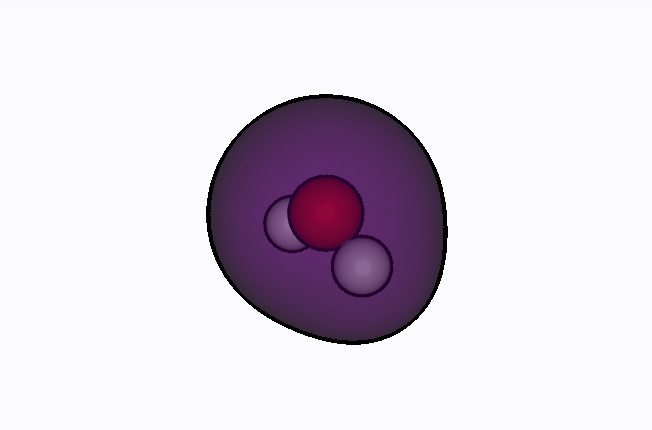
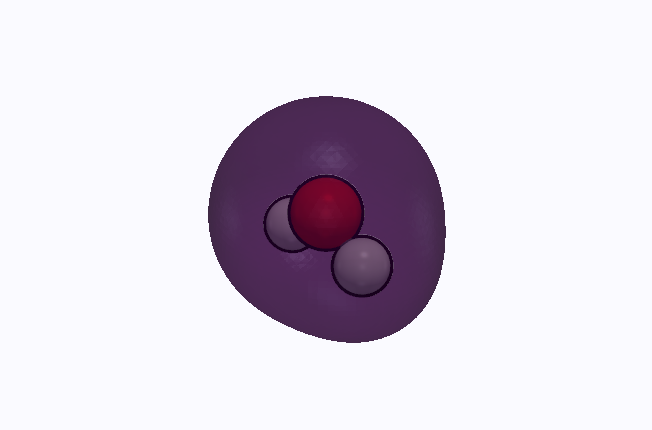
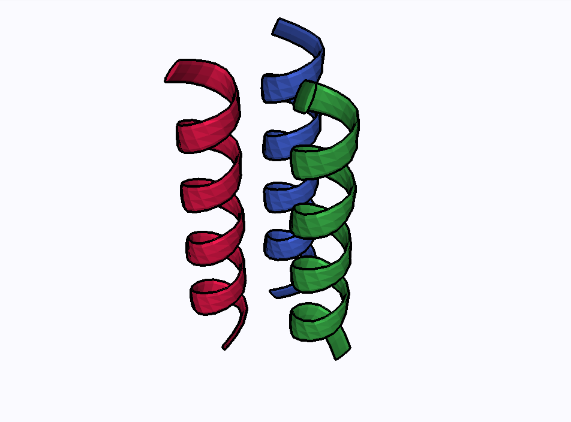
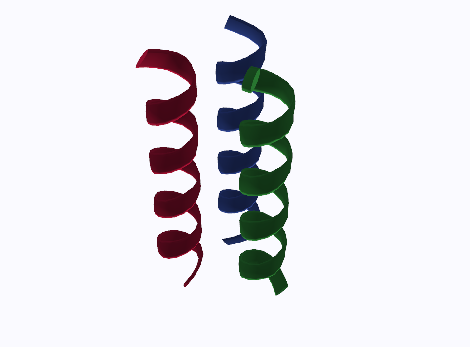

# Figures without a display

The rendering and export commands on this page use the **core install**:
no `[viewer]` extra or browser is required. The validation steps additionally
need the [qvf reference validator](qvf.md#strict-validation). Use these
commands in a batch pipeline or a figure script for a paper. The data and
geometry conventions are shared with the browser; the offscreen and browser rendering backends differ,
so a PNG is not a pixel-identical capture of your browser session.

One caveat separates the two halves of the page. PNG capture, video and the
scene exporters render through VTK, which needs an offscreen OpenGL context
even with no display attached. Terminal rendering and the vector and data
exporters need nothing at all.

## Setting up a headless host

```sh
vibe-view capture-selftest
```

renders a tiny built-in structure through the real capture path, checks the
PNG is not blank, and reports the render backend. Exit 0 means capture works
here; non-zero means a stage of the capture check failed. Read the reported
stage and error before assuming the GL stack is missing. Run it before the
first real capture on a new host, and as a healthcheck in a queue or CI job.

On a bare Linux container the usual fixes are a Mesa runtime and a virtual
framebuffer:

```sh
apt-get install libgl1 libglx-mesa0 libxrender1 libxext6 libsm6 libglib2.0-0 xvfb xauth
PYVISTA_OFF_SCREEN=True xvfb-run -a vibe-view capture job.qvf -o structure.png
```

`PYVISTA_OFF_SCREEN=True` tells PyVista not to look for a window; set it in
the environment of any script that captures. If a GL context is impossible
on a host, `vibe-view show` and `render_terminal` still work, because they
never touch one.

## `vibe-view capture`

```sh
vibe-view capture job.qvf -o structure.png                     # the structure
vibe-view capture job.qvf -s vol_dens_0 -o density.png         # a volume section
vibe-view capture job.qvf -s vol_mo_0 --isovalue 0.03 --colormap RdBu -o homo.png
vibe-view capture job.qvf -s bands -o bands.png
```

`-s` selects a section **ID** from `vibe-view info FILE.qvf`. The CLI
supports structures, stored volumes / `basis.ao`, vector, complex and series
fields, forces (the structure with its force arrows), electric properties
(the dipole arrow), Bloch orbitals (the opening orbital, with `--part` and
`--isovalue`), and bands; a `volume.complex` section takes `--part real|imag|modulus`
(default `real`) and `--isovalue`, and prints the part and level it drew; a
`volume.series` section takes `--frame N`, the slab counted from 0 (default
0), draws it on that slab's trajectory frame when the series names one, and
refuses a slab outside the series; `batch --volumes` draws its first slab;
a `volume.vector` section is drawn as the browser's arrows, prints how many
it drew, and ignores `--isovalue`; `batch --volumes` draws it the same way.
Other kinds
need the [capture API](#the-capture-api) or the browser export controls.
Volumes take `--isovalue` and `--colormap`. `--size WxH` sets structure and
volume image dimensions; the default is `900x600`. Bands use their chart
renderer rather than the 3-D image-size setting, and draw their energy axis
in the browser's saved **Band / DOS energy unit**. `--publication` renders a
structure or a volume section in the browser's *Publication* view preset: the
scientific material on a near-white background, with a black outline around
every atom and bond. Isosurfaces and ribbons are not outlined in a headless
image; see {ref}`outlines in the browser and headless <silhouette-outlines>`.
`--render` draws a volume section as its `isosurface` or as a
`volume`, the browser's {ref}`volume mode <volume-mode>` off-screen: the
same capped grid, the same transfer function from the section's hint or
the kind's preset, so a figure and the viewer agree. The default, `auto`,
follows the section's `render` hint and draws the isosurface when there is
none, so an archive without the hint captures exactly as before.
Replication and `--isovalue` apply to the isosurface only; a skewed grid
is resampled onto its axis-aligned bounding box, as the browser does.
Without `-o`, the PNG is written beside the archive as `<stem>_<section>.png`
(`<stem>_structure.png` for the structure); `animate` and `export` follow the
same rule with their own suffixes.

Signed volumes retain both lobe colours and the grid's full voxel-vector
geometry, including skewed grids and reversed axes, as in the browser viewer.

`capture` renders supported stored fields and the opening orbital of a
`wavefunction.bloch` section. It has no flag for evaluating a selected
orbital from a molecular `wavefunction.gto` section on demand; the
[Python API](#the-capture-api) can do that.

(silhouette-outlines)=
### Outlines in the browser and headless

The outline of the *Publication* look comes in two kinds. Atoms and bonds
get a black inverted hull, geometry the server adds, so it is the same in the
browser and in every headless image. Isosurfaces and cartoon ribbons are
outlined only in the browser, by a pass that runs on the graphics card for
each frame, because their silhouettes and folds change with the view. A
headless capture renders on the server, which has no such pass. The
browser's **Export screenshot** saves the frame the browser draws, outlines
included, so take a figure with outlined isosurfaces or ribbons from the
browser; see {ref}`Screenshots <screenshot-export>`.

The same two views, a water density at its default opacity and three helices
as a cartoon, in the browser (left) and from the headless capture with
`--publication` (right), at the same size and isometric camera:

| Browser | Headless capture |
|---|---|
|  |  |
|  |  |

`docs/capture_silhouette_figures.py` regenerates these four images, and
`docs/bench_silhouette.py` measures what the pass costs during a drag.

## Keep a figure reproducible

Record the archive, section ID, viewer version, contour and output size
alongside the image. For example, after selecting a stored density section
whose ID is `density`:

```sh
vibe-view --version > figure-version.txt
vibe-view info calculation.qvf --json > figure-input.json
vibe-view validate calculation.qvf
vibe-view capture calculation.qvf -s density --isovalue 0.05 --size 1600x1000 -o density.png
```

Replace `density` with your actual section ID. Report the units supplied by
the producer and retain the original QVF; a PNG cannot recover the numerical
field. To compare two surfaces, keep their contour and view settings fixed.
For a runnable structure-only example, use [the worked workflow](workflows.md).

## `vibe-view batch`

```sh
vibe-view batch runs/*.qvf                       # one structure PNG per archive
vibe-view batch runs/*.qvf --volumes -o gallery/ # plus one PNG per volume section
vibe-view batch a.qvf --size 1200x800
```

Renders a gallery from many archives with the same view defaults, one PNG
per section, into `./vibe-view-gallery` unless `-o` says otherwise. No
server is started. `vibe-view dashboard PATTERNS...` builds a grid preview
of many files instead, as one image or, with `--html`, one page.

### Output names and partial failures

Without `--volumes`, `batch runs/water.qvf -o gallery` writes
`gallery/water.png`. With `--volumes`, it writes into `gallery/water/`,
including `structure.png` and `<section-id>.png` for each captured field.
The source directory is not part of the output name: inputs such as
`run-a/water.qvf` and `run-b/water.qvf` collide in one gallery. Use a separate
output directory for each run or distinct archive basenames. Existing image
names can be overwritten; use a fresh gallery directory to preserve a run.

The command continues after individual file failures and prints a final
`rendered N/M file(s)` summary. Exit status is unsuccessful when no files
render, but a partial batch can exit successfully. With `--volumes`, a file
counts as rendered when at least one image was written, not when every
section succeeded. For an automated figure set, check the summary and
expected images; do not use the exit status alone as proof of completeness.

Quote a glob to let the command expand it, for example
`vibe-view batch 'runs/*.qvf' -o gallery`. Only matched `.qvf` files enter
the batch; import loose inputs first.

Every headless image, from `capture`, `batch`, `dashboard`, the `animate`
frames and the Jupyter helper, is rendered the same way: the dark vibe-view
background and an isometric camera fitted to the scene. Only
`capture --publication` departs from that background, on purpose.

## `vibe-view animate`

```sh
vibe-view animate opt.qvf                              # auto-detect: trajectory, reaction path, vibrations or orbitals
vibe-view animate neb.qvf --kind reaction              # reactant → transition state → product
vibe-view animate vib.qvf --kind vibration            # the first real (positive-frequency) mode
vibe-view animate vib.qvf --kind vibration --mode 7    # one normal mode, 1-based
vibe-view animate opt.qvf -k trajectory --fps 8 --format gif
vibe-view animate si.qvf  --kind turntable -o rotation.mp4
```

Without `--format`, the format follows the `-o` name: `rotation.gif` writes
a GIF and `rotation.mp4` an MP4; any other name, or none, means MP4. A
`--format` that contradicts a `.gif` or `.mp4` name is refused before any
frame renders.

MP4 needs `ffmpeg` on `PATH`; without it the command falls back to GIF when
Pillow is installed. `--format frames` writes the individual PNGs instead.
`--kind auto`, the default, takes the first of `trajectory`,
`reaction.path`, `vibrations` or `wavefunction.gto` it finds, then falls
back to a structure turntable. A geometry-only demo can therefore animate
without any calculated modes. `--kind orbital` sweeps every orbital of a
Gaussian wavefunction at `--isovalue`; it does not animate Bloch orbitals.

GIF export keeps at most one input PNG open at a time, including the MP4
fallback, so long sequences do not keep a file handle for every frame.
Decoded frames stay in memory until GIF encoding finishes.

## Export

```sh
vibe-view export job.qvf -f xyz -o geometry.xyz
vibe-view export job.qvf -f html -o viewer.html
vibe-view export job.qvf -f pov -o scene.pov
```

Twelve formats, none of which needs a display:

| `-f` | Writes | Notes |
|---|---|---|
| `xyz`, `cif`, `cml`, `json` | The structure | CIF carries fractional coordinates with a periodic cell, or Cartesian Å coordinates for a molecule; no box is invented. |
| `py` | A vibe-qc input script | Reuses the archive's own provenance (method, basis, functional) so the script reproduces the calculation, and carries the lattice so a periodic file exports a periodic system. |
| `obj`, `gltf` | A mesh of atoms and bonds | glTF 2.0 with PBR materials, for any 3-D tool. |
| `pov` | A POV-Ray scene | CPK spheres and bond cylinders with finish blocks, three-point studio lighting, the cell wireframe for a crystal. Render with `povray +W3840 +H2160 +A +Q11 scene.pov`. |
| `blend` | A Blender Python script | Builds the scene when run with `blender --python scene.py`: Cycles, principled materials, three area lights, an auto-framed camera, a transparent film. `blender --background --python scene.py -o //out.png -f 1` renders it headlessly. |
| `html` | A shareable structure page | Opens without a Python server, but fetches Three.js from a CDN and therefore needs network access. It carries the geometry, not the full QVF analysis panels. |
| `svg` | Vector graphics | CPK circles and bond lines, for journals that want line art. |
| `pdf` | A vector PDF | For `\includegraphics`. |

Python exports preserve literal parameter text, including quotes, backslashes
and line breaks in output names. Each line of a multiline calculation title
remains a comment. The same formatting is used by the calculation panel and
queue input generation.

XYZ and CIF exports replace line breaks in source filenames and supplied
comments with spaces, keeping provenance on one comment line so it cannot
be mistaken for geometry or CIF data when reopening the file.

Flat SVG and PDF figures fit the complete drawn atom circles, with their
style-dependent radii and surrounding margin. Large atoms in space-filling
figures keep their full outlines in both vector PDF output and the raster
fallback used when matplotlib is unavailable.

Every export carries the connectivity the viewer shows: the archive's
explicit bonds when it has them, with their orders, otherwise the same
covalent-radius inference. POV-Ray scenes draw a bond through a periodic
cell face to the image it reaches; CML, the Blender script, the standalone
HTML page and the flat SVG and PDF figures address atoms by index and leave
such bonds out.

The browser's *Export geometry / scene* menu offers the same formats.
Both CIF export paths use the same coordinate convention and write unique
atom-site labels separately from element symbols. A stored cell with
all QVF periodic flags disabled is treated as molecular. CIF cell parameters
do not preserve individual QVF periodic-axis flags. The
interactive **High-Quality Raytrace Render** is browser-only; from a script,
`vibeview.raytrace.RaytraceEngine` drives the same OSPRay path tracer when
the installed VTK ships it.

## Tables and data

```sh
vibe-view table job.qvf                                  # what is tabulatable
vibe-view table job.qvf --kind atom_properties --format csv > charges.csv
vibe-view table job.qvf --kind wavefunction.gto --format json
vibe-view table job.qvf --kind vibrations --format csv > modes.csv
vibe-view info  job.qvf --json
```

Ten kinds are tabulatable: `wavefunction.bloch` (its orbitals at every
k-point), the three `properties.*` kinds (one row per number), `forces` (the force on each atom, F = −∇E),
`hessian` (its harmonic frequencies), `vibrations` (with IR, Raman and VCD intensities,
reduced masses, force constants and symmetries when the archive has them),
`atom_properties`, `wavefunction.gto` and `excited_states`. See the [CLI reference](cli.md) for `diff`,
`batch-compare` and `stats`, and the [Python API](python_api.md) for the
same data as Python objects.

## The capture API

Every function on the public SDK takes a path, bytes, a file object or an
open reader, and returns `True` on success:

```python
from vibeview import capture_structure, capture_volume

capture_structure("job.qvf", "structure.png",
                  representation="space_filling", show_labels=True, replication=(2, 2, 1))
capture_volume("job.qvf", "vol_dens_0", "density.png",
               isovalue=0.05, colormap="viridis", opacity=0.6, size=(1600, 1000))
```

The lower-level module covers the chart and table kinds too. These take an
open `QVFReader` and auto-detect the section when none is named:

| Function | Output |
|---|---|
| `capture_structure(reader, path, ...)` | PNG |
| `capture_volume(reader, section_id, path, ...)` | PNG |
| `capture_bands(reader, path, ...)` | PNG |
| `capture_dos(reader, path, ...)` | HTML |
| `capture_spectra(reader, path)` | HTML |
| `capture_scf_history(reader, path)` | HTML |
| `capture_bond_orders(reader, path)` | HTML |
| `capture_energy_diagram(reader, path)` | HTML |
| `capture_selftest(output=None, size=(400, 300))` | a dict describing the render backend |

```python
from vibeview import QVFReader
from vibeview.capture import capture_bands, capture_dos, capture_scf_history

with QVFReader("crystal.qvf") as r:
    capture_bands(r, "bands.png")
    capture_dos(r, "dos.html")
    capture_scf_history(r, "scf.html")
```

`capture_bands` and `capture_dos` frame the energy axis the way the viewer
does: an all-electron archive opens on its valence states rather than
autoscaling over core levels thousands of eV below E_F. Pass
`energy_window=(min, max)` in eV relative to E_F for a specific window, or
`auto_window=False` for the full range. See
{ref}`the bands and DOS panels <bands-dos-panel>`. Both take `energy_unit`
(`"ev"`, `"hartree"` or `"kcal_mol"`; eV unless given), `capture_energy_diagram`
takes it with a Hartree default, and `capture_bond_orders` takes `length_unit`
(`"angstrom"` or `"bohr"`) for its distance column; the CSV that page offers
stays in Å. The API does not read the browser's settings; the `capture`
command does.

```python
capture_bands(r, "bands.png", energy_window=(-15.0, 10.0))
```

The chart kinds other than bands write interactive HTML through Plotly; for
a PNG of one of those, save the figure with matplotlib from your own script,
or screenshot the page.

To render an orbital that is not stored as a grid, evaluate it first:
`vibeview.renderers.wavefunction.WavefunctionRenderer` has `evaluate_mo`,
`evaluate_density`, `evaluate_spin_density`, `evaluate_elf` and
`evaluate_nci`. That module is below the supported surface, so pin the
version you script against.

## The animation API

```python
from vibeview import QVFReader
from vibeview.animation import (
    render_trajectory_video, render_reaction_video,
    render_vibration_video, render_orbital_animation,
)

with QVFReader("neb.qvf") as r:
    render_reaction_video(r, "neb.mp4", fps=5, format="mp4")
with QVFReader("vib.qvf") as r:
    render_vibration_video(r, "mode7.gif", mode=7, n_frames=60, fps=15, format="gif")
```

Each returns the output path, or `None` when the archive has no matching
section. `render_turntable` takes a PyVista plotter rather than a reader and
orbits the camera through a full rotation.

## Recipes

**A figure set for a paper**

```sh
export PYVISTA_OFF_SCREEN=True
mkdir -p figs
vibe-view capture result.qvf -o figs/structure.png --size 1800x1200
vibe-view capture result.qvf -s vol_dens_0 -o figs/density.png
vibe-view capture result.qvf -s vol_mo_0 -o figs/homo.png --colormap RdBu
vibe-view export  result.qvf -f svg -o figs/structure.svg
```

**Checks for an existing validation job**

Install the reference validator and `jq` before running this recipe. In Bash, stop
on a failed command or pipeline so a later successful capture does not hide
a validation failure:

```bash
set -euo pipefail
vibe-view validate result.qvf
vibe-view diff result.qvf reference.qvf --json | jq '.delta_e_kcal_mol'
vibe-view capture-selftest && vibe-view batch results/*.qvf -o gallery/
```

**Everything about one file, as text**

```sh
vibe-view show result.qvf --all --plain > report.txt
```

That last one needs no GL at all, so it is the one to attach to a job's log.
